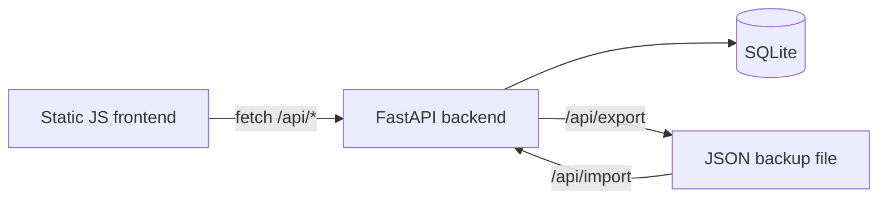

# CashFlow

A percentage-based income allocation planner — split income across spending/saving categories by percentage, model multiple scenarios, and track progress toward category targets (including Roth contributions). No real financial data ships with this repo.

## Why I built this

Most budgeting tools assume fixed dollar amounts per category, which falls apart the moment income is irregular. I wanted something built around percentages instead — drag a slider, every category's dollar amount recalculates — and something I could run entirely locally with my own data in my own database, not a third-party budgeting SaaS.

## Architecture



- **Scenarios** hold independent sets of income streams and categories, so you can model "what if" allocations side by side.
- **Income streams** (one or more per scenario) each have their own gross amount and optional tax rate.
- **Categories** hold a percentage of total income, can be locked (excluded from auto-rebalancing when other sliders move), flagged as Roth, and given a target balance.
- Category percentages are written atomically as a batch after a drag gesture settles, not on every intermediate frame.

## Tech stack

| Layer | What | Why |
|---|---|---|
| Backend | Python, FastAPI, Pydantic models | Small, typed, fast to iterate on for a single-user local tool |
| Data | SQLite | Zero-ops local storage; the whole app is one file plus a DB |
| Frontend | Vanilla JS, HTML, CSS | No build step — the entire frontend is static files FastAPI serves directly |
| Backup | JSON export/import | Full scenario/category/stream state round-trips through a single downloadable file |

## How to run it

```bash
pip install -r requirements.txt
python main.py
```

Opens on `http://localhost:8000`. By default the server binds to all interfaces (`0.0.0.0`) — if you run this anywhere other than your own machine, put it behind a reverse proxy or change the bind address first; this was built as a local single-user tool, not a multi-tenant service.

## What I learned

- Percentage-based allocation is a genuinely different data model than fixed-dollar budgeting, not just a UI skin on the same thing — locked categories and rebalancing logic took more iteration than expected to get right.
- Writing slider state as one atomic batch after the drag settles (instead of on every pointer-move event) avoids both UI jank and a flood of tiny writes to SQLite.
- Building the export/import path early, before the schema stabilized, made every later schema change much less risky — there was always a known-good way to snapshot and restore real data.

## Screenshots

*(placeholder — add a scenario view and the category-percentage sliders here)*
